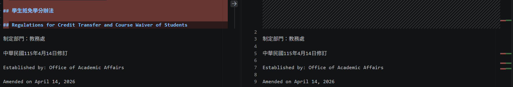
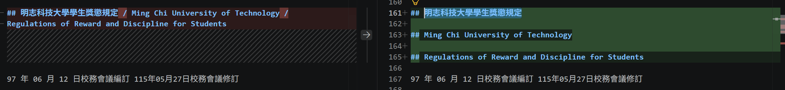
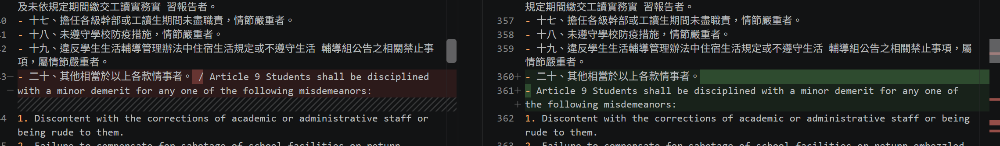
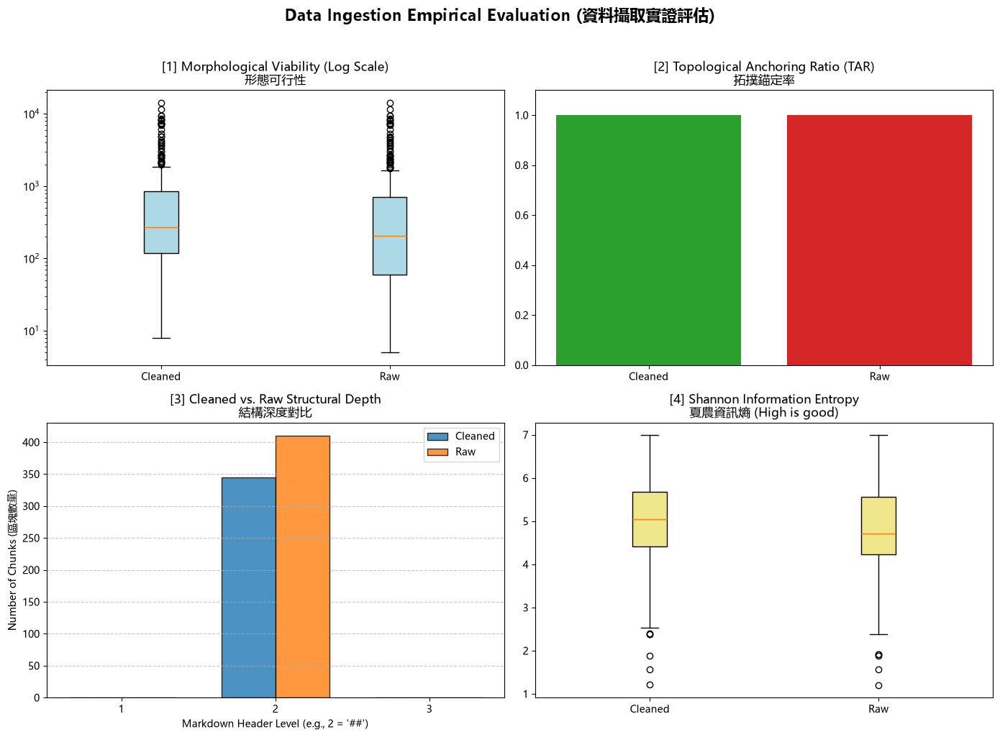

# 資料前處理報告 (Data Preparation Report)

> 期中評量 · NLP 自然語言處理 115-S1
> 填寫方式：請把所有「（ ）」與 `___` 替換成你自己的內容，並刪除 `>` 開頭的說明文字。

- **學號 / 姓名**：U12627018/高浩倫
- **專案名稱**：正則表示法的教學
- **完成的任務**：- [x] 1-A 頁首頁尾清除　- [x] 1-B 雙語標題合併　- [x] 1-C 雙語條文合併

---

## 1. 資料集概覽 (Dataset Overview)

> 數字來源：`01_Data_Ingestion.ipynb` 第 2 節 (掃描 PDF) 與第 5 節 (批次處理) 的輸出。

| 類別 (Cluster) | PDF 數量 | 清洗前 chunk 數 | 清洗後 chunk 數 |
|---|---|---|---|
| Academic_Affairs | 3 | 96 | 65 |
| Library_Information | 3 | 248 | 225 |
| Student_Affairs | 3 | 66 | 55 |
| **合計** | 9 | 410 | 345 |

**問題 (2–3 句)：** 清洗後 chunk 數量變少了多少？是哪個任務造成的？有沒有哪個任務**不影響** chunk 數量？為什麼？


> 提示：chunk 是用什麼規則切開的？請看 notebook 第 5 節的 `chunking_regex`。

清洗後 chunk 從 410 減到 345，少了 65 個。chunk 是用 ## 標題切開的，所以會減少數量的是會動到 ## 的任務：1-A 刪掉整行只有法規名稱的 ## 標題，1-B 把連續的中英文 ## 標題合併成一個。1-C 只合併條文（- 開頭接到 Article），不新增也不刪除 ##，所以不影響 chunk 數量。

## 2. 清洗步驟 (Cleaning Steps)

> **截圖來源：** `data/interim/<類別>/` 中的 `raw_*.md` (清洗前) 與 `cleaned_*.md` (清洗後)，也就是批次處理存下的**真實檔案**。
>
> **[重要] 不可使用 notebook 中的範例。** notebook 任務 1-A、1-B、1-C 的測試文字 (第二十一條、明志科技大學 / Ming Chi University of Technology、第十五條 / Article 15) **不能**作為你的截圖。請在真實檔案中**另找一處**，可以是其他 PDF 的檔案。使用範例的截圖**不給分**。
>
> **截圖方法 (VS Code 比較檢視)：**
> 1. 在檔案總管對 `raw_<檔名>.md` 按右鍵 → **Select for Compare**。
> 2. 對同一份文件的 `cleaned_<檔名>.md` 按右鍵 → **Compare with Selected**。
> 3. 左右並排顯示，紅色 = 刪除，綠色 = 新增或修改。按 `Ctrl + F` 搜尋，找到該任務造成的變更。
> 4. 每個任務截**一張**圖，存到 `reports/figures/`，**檔名必須完全相同** (否則圖片不會顯示)：
>    * 任務 1-A → `1a_compare.png`
>    * 任務 1-B → `1b_compare.png`
>    * 任務 1-C → `1c_compare.png`

### 2.1 任務 1-A：頁首頁尾溢出清除

- 檔名：a232060013_學生抵免學分辦法　搜尋的文字：學生抵免學分辦法
- 截圖 (存為 `reports/figures/1a_compare.png`)：
- 改變了什麼：刪掉正文裡整行只有法規名稱的多餘標題，例如 `## 學生抵免學分辦法`。條文和其他內容保留。
- 這對之後的問答檢索有什麼幫助：避免搜尋時被頁首頁尾的重複標題干擾，讓真正的條文更容易被找到。  
- 這個任務有沒有**改錯**的地方 (把不該改的也改了)？若有，寫出檔名與搜尋的文字；若沒有，寫「沒有發現」:沒有發現

### 2.2 任務 1-B：雙語標題合併

- 檔名：a242030012_學生獎懲規定　搜尋的文字：明志科技大學學生獎懲規定
- 截圖 (存為 `reports/figures/1b_compare.png`)：
- 改變了什麼：
- 這對之後的問答檢索有什麼幫助：
- 這個任務有沒有**改錯**的地方 (把不該改的也改了)？若有，寫出檔名與搜尋的文字；若沒有，寫「沒有發現」：沒有發現

### 2.3 任務 1-C：雙語條文合併

- 檔名：a242030012_學生獎懲規定　搜尋的文字：/ Article 9
- 截圖 (存為 `reports/figures/1c_compare.png`)：
- 改變了什麼：把中文條文最後一行和後面的英文條文合併成一行，中間加上 ` / `，並拿掉英文條文前面的 `- `。
- 這對之後的問答檢索有什麼幫助：中英文條文對齊後，搜尋中文或英文都能對到同一條規定，不會被拆成兩段。
- 這個任務有沒有**改錯**的地方 (把不該改的也改了)？若有，寫出檔名與搜尋的文字；若沒有，寫「沒有發現」：沒有發現

## 3. 評估指標與 AI 解讀查證 (Metrics & Verifying the AI's Interpretation)

### 3.1 指標數據表

> 數字來源：專案根目錄的 `metrics.json`。[1]、[2] 必填；[3]、[4] 選填。
> 「參考值」由老師在課堂上公布 (完成全部任務的結果)。

| 指標 | Raw | Cleaned (你的) | Cleaned (參考值) |
|---|---|---|---|
| [1] 中位數長度 Median Length | 205|273|270.5|
| [2] 拓撲錨定率 TAR | 1.0|1.0|1.0|
| [3] 深度變異量 SDV (選填) |0.0|0.0|0.0|
| [4] 中位數資訊熵 Entropy (選填) |4.72| 5.05|5.06|

> **儀表板截圖：** 你自己的 `01_Data_Ingestion.ipynb` **第 6 節**輸出的 4 拼圖儀表板 (第 8 週執行並保留的輸出)。截圖後存為 `reports/figures/dashboard.png`。第 3.2 節也會用到這張截圖。



你的 Cleaned 結果與參考值一致嗎？若一致，寫「一致」；若不一致，找出原因。（1 句）

不完全一致。TAR 與 SDV 相同，中位數長度（273 vs 270.5）和資訊熵（5.05 vs 5.06）僅有微小差距，應為四捨五入或清洗細節差異所致。

### 3.2 AI 的解讀

> 把第 3.1 節的儀表板截圖 (`dashboard.png`) 交給 AI，請它解讀結果。將 AI 的回答**完整貼在這裡**，並註明使用的 AI 工具。

- 使用的 AI 工具：grok

```text
這四張圖是清洗前後的資料品質比較，解讀如下：[1] 形態可行性（中位數長度）

箱型圖顯示 Cleaned 與 Raw 的區塊長度分布接近，中位數都在約 200–300。Cleaned 略高（約 273），代表清洗後段落長度更集中、沒有把內容切得更碎。上方離群值兩邊都有，屬正常長文。[2] 拓撲錨定率 TAR

Cleaned 與 Raw 都是 1.0，代表標題結構都有正確錨定，清洗沒有破壞文件的層級關係。[3] 結構深度對比

只在 Markdown 二級標題（##）有區塊。Raw 約 405 個，Cleaned 約 345 個，清洗後數量下降，符合刪除多餘標題、合併雙語標題後區塊變少的預期。[4] 夏農資訊熵

Cleaned 中位數約 5.05，略高於 Raw 的約 4.72。熵越高表示資訊越豐富，清洗後沒有損失內容，反而略為提升。整體而言，清洗後結構更乾淨（區塊數下降）、資訊量沒有下降，TAR 維持滿分，代表這次前處理是有效且安全的。
```

### 3.3 你的查證 (至少兩點)

> 挑 AI 說得最肯定的兩句話，回到你的檔案或程式中找證據：它說的是真的嗎？

**查證 1**
- AI 的說法：Cleaned 的中位數長度約 273，高於 Raw 的 205
- 我查了什麼 (哪個檔案、哪個 chunk、哪段程式)：專案根目錄的 metrics.json，欄位 形態可行性 。
- 結論：正確 / 部分正確 / 錯誤。 正確，因為 json 裡 Raw 是 205.0、Cleaned 是 273.0，與 AI 說法一致。

**查證 2**
- AI 的說法：TAR 清洗前後都是 1.0，資訊熵 Cleaned（約 5.05）高於 Raw（約 4.72）。
- 我查了什麼：metrics.json的 拓撲錨定率 與 夏農資訊熵。
- 結論：正確 / 部分正確 / 錯誤。 正確，因為 TAR 兩邊都是 1.0；熵 Raw 約 4.72、Cleaned 約 5.05，與 AI 說法一致

### 3.4 實際證據：你被指定的 chunk

> 執行 `09_midterm_chunks.ipynb`：填入你的學號與老師在課堂上公布的 SEED，按 Run All。
> 每位同學拿到的 chunk 不同。請**連同驗證碼**一起填入。
> 程式只顯示前 400 字元的預覽。請在 VS Code 打開程式列出的**閱讀用檔案** (`data/interim/` 中的 `cleaned_*.md`，與 JSON 內容相同但有正常換行)，按 `Ctrl + G` 輸入程式給的**行號** (或按 `Ctrl + F` 搜尋「搜尋用」文字)，從該行讀到下一個 `## ` 標題為止，就是**完整**的 chunk。

- **SEED**:1106

**(a) 很長的 chunk**
- 資料檔 (JSON)：位置：第 6 個（從 0 開始數） 長度：7490 字元 驗證碼：9a4d4125
- 閱讀用檔案（`.md`）：cleaned_A242030012_學生獎懲規定.md 從第 367 行開始
- 前 3 行內容：
  ```text
  ## 第十條 凡有下列各款情形之一者，予以大過處分。

- 一、冒用、假借、塗改、偽造文書及證件者。
- 二、借與他人使用己有證件致妨礙他人權益者。
- 三、冒用師生帳號密碼，破解使用電腦之保護措施，或篡改學校
- 系統資料者。
  ```
- 這是什麼樣的文字？為什麼會這麼長？這是「第十條」大過處分的完整條文，下面列了很多款違規情形。清洗後整條被放在同一個 chunk，款項一多，字數就累積到 7490 字。
- 之後做問答檢索時，這麼長的 chunk 可能造成什麼問題？檢索時可能抓到整條但問題只關其中一款，多餘內容會稀釋重點，也比較容易超出模型上下文長度，回答容易不精準或漏掉細節。

**(b) 資訊熵很低的 chunk**
- 資料檔 (JSON)：cleaned_A271010023_圖書館管理作業規範_processed.json　位置：第 161 個 (從 0 開始數)　資訊熵：2.99　驗證碼：1d64d522
- 閱讀用檔案 (`.md`)：cleaned_A271010023_圖書館管理作業規範.md　從第 1794 行開始
- 內容：
  ```text
  ## 明志科技大學圖書館 非專任教職人員借閱服務申請單

| 讀    | 填表日期 身分證字號/ 護照號碼   | 西元 年 月 日                                                                                                                  | 姓名 聯絡 電話                                                                                                                 |
|-------|---------------------------------|---------------------------------------------------
  ```


## 4. 一個尚未解決的問題 (One Remaining Problem)

> 打開 `data/interim/` 中任一個 `cleaned_*.md` (與 `data/processed/` 的 JSON 內容相同，但有正常換行，比較好讀)，找出一個清洗後**仍然有問題**的 chunk。
> 每個 chunk 從一個 `## ` 標題開始，到下一個 `## ` 標題之前結束。
> 例如：只有標題沒有內文、表格亂掉、中英文沒有對齊、還有殘留的頁首頁尾、斷行造成的多餘空白，或是**清洗造成的錯誤** (誤合併、誤刪除)。
> **不可**使用第 3.4 節的兩個 chunk。
- **檔名** (`cleaned_*.md`)：a242100008_學生機車管理辦法　**從第 1 行開始** (VS Code 左側的行號)　**標題**：## 明志科技大學 / Ming Chi University of Technology / Regulations on Management of Student Motorcycles
- **我是怎麼找到的** (例如：搜尋了什麼、看了哪個檔案)：我收尋了##然後看到看到修訂記錄區塊中英文擠在一起。
- **問題 chunk (貼上部分內容)**：


```text
Amended on 08 19, 2025

89.05.15校務會議制訂
Established by the University Council Meeting on 2000. 05. 15 92.05.12校務會議修訂
Amended by the University Council Meeting on 2003.05.12 92.09.01校務會議修訂

目
錄

## Table of Contents
```

- **問題是什麼**：修訂記錄的中文和英文擠在同一行，日期格式不完整
- **可能的原因** (PDF 本身？Docling 轉換？清洗的正則表示式？切塊規則？)：主要是 PDF 轉 Markdown（Docling）時，雙欄或換行對不齊，清洗的正則只處理標題和條文合併，沒有修訂記錄這種中英交錯的格式。
- **具體的修正方法** (例如：一條規則、一個正則表示式的構想、長度上限)：可加一條規則，把「英文修訂句」和緊接的「民國日期+校務會議」拆開；或用正則把 `on 2000. 05. 15 92.05.12` 這類中英黏在一起的地方斷行。另外把「目\s+錄」合併回「目錄」。
- **對問答檢索的影響**：使用者若問修訂日期或制定單位，檢索容易抓到混雜的一行，回答可能把中英文日期對錯，或漏掉某次修訂。

## 5. AI 協作 (AI Collaboration)

- 本次作業的 AI 協作紀錄請見 [`AI_USAGE.md`](AI_USAGE.md) 的「Week 04 / 08」與「Week 09」段落。
- 這次使用 AI 最大的收穫或教訓是 主要是能舉例之前的範例，用之前的範例去給提示，錯誤的部分部前沒有找到（請具體：例如提示詞中哪一段最關鍵、AI 哪一句解讀不正確）
